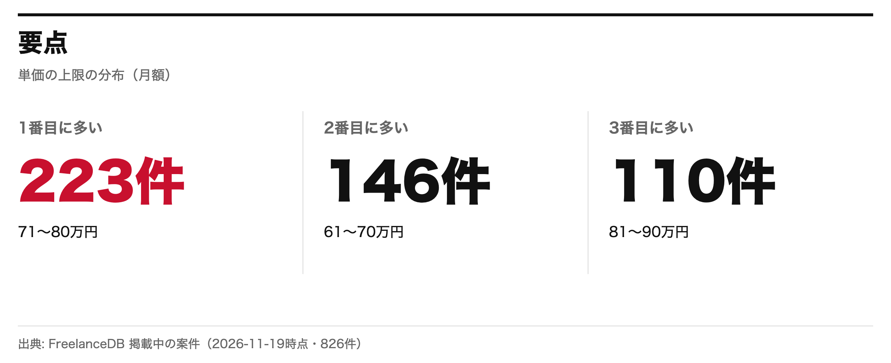
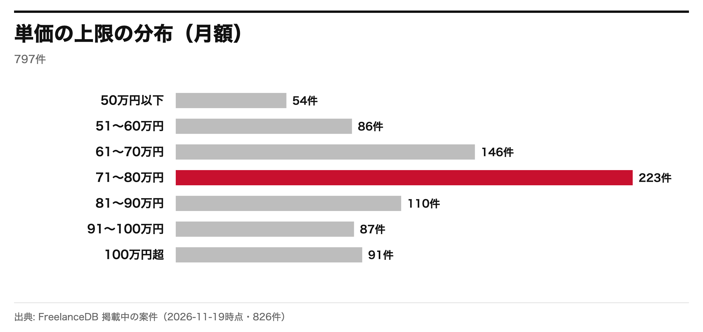
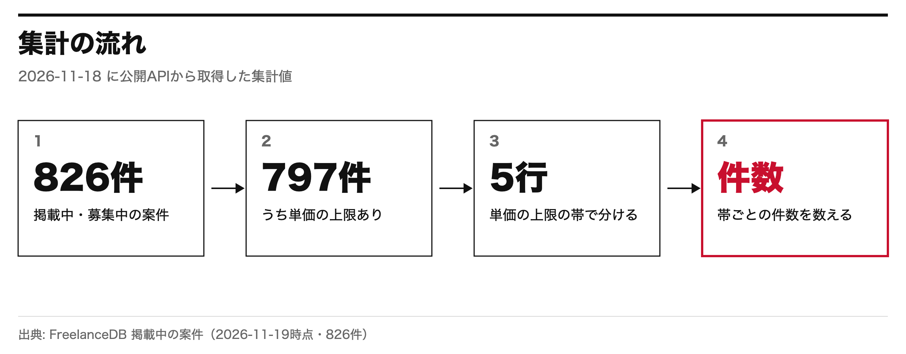

月80万円以上の案件は457件で、単価の上限がわかる797件の57%を占めます。ここでの数字は募集に書かれた単価の上限であり、実際の契約額ではない点にご注意ください。自分のスキルに近い単価帯を表で確かめたうえで、次の案件や単価を決める材料にしてください。

## 月80万円以上は797件の57%を占める

*図1 要点（単価の上限の分布（月額））*

- 月**90万円**以上の案件は238件で、797件の30%を占めます。
- 月**100万円**以上は152件(**19%**)、月**120万円**以上は72件(**9%**)です。
- 月**150万円**以上の案件は8件で、全体の1%にとどまります。

## 最も多いのは71〜80万円の223件

*図2 単価の上限の分布（月額）*

## 単価の上限が一定額以上の案件

| 単価の上限 | 件数 | 全体（797件）に占める割合 |
|---|---|---|
| 月80万円以上 | 457件 | 57% |
| 月90万円以上 | 238件 | 30% |
| 月100万円以上 | 152件 | 19% |
| 月120万円以上 | 72件 | 9% |
| 月150万円以上 | 8件 | 1% |

## 集計のしかた

*図3 集計の流れ*

集計値は FreelanceDB の公開API https://freelance.radineer.asia/api/public/market-stats から2026-11-19に取得しました。案件ごとの単価の上限から、中央値と「真ん中の半分」（25〜75パーセンタイル、最も近い順位の値）を出しています。

## 対象と前提

:::message
- 2026年11月19日時点で掲載中・募集中の案件 826件。月額の単価の上限がわかるのは 797件
- 値は募集に書かれた「単価の上限」。実際の契約額ではない
- 月10万円未満・月300万円超は入力の誤りとして除外
- すべて1つの掲載元の案件で、勤務地は東京が中心。市場全体の相場ではない
- 全体の中央値は 80万円、真ん中の半分は 70万円〜90万円、最高は 150万円
:::

## 自分の単価帯を表で確かめて次の案件を選ぶ

まずは自分が希望する単価の上限が表のどの行に当たるかを確認してください。例えば月**100万円**以上を希望する場合、該当するのは797件のうち152件です。該当件数の多さや少なさを見て、次に応募する案件の単価の目安にしてください。

## 自分のスキルで確かめる

スキルと働き方を選ぶと、掲載中の案件の単価の上限の目安が出るページを用意しています。登録なしで使えます。

- [スキル別 単価の目安を見る](https://radineer.asia/freelance/calculator?utm_source=zenn&utm_medium=article&utm_campaign=data-cta)
- 希望の単価や働き方を送ると、合う案件を担当者が探してお送りします（無料）: [案件の相談をする](https://radineer.asia/freelance/register?utm_source=zenn&utm_medium=article&utm_campaign=data-cta)

## この集計で言えないこと

:::message alert
- 実際の契約額（ここにあるのは単価の上限）
- 商流の段数（エンド直か何次請けか）
- 経験年数ごとの違い（案件データに経験年数の項目がない）
:::

## 次回

毎朝8時に、掲載中の案件を1つの切り口で数えて出しています。次回は、案件に付いているスキルの数ごとの単価の上限を数える予定です。自分のスキルの数字が出たときに見逃さないよう、フォローしておいてください。

---

この記事は、フリーランス向け案件サイト「FreelanceDB」（合同会社Radineer）の運営者が書きました。
コンサル・PMO領域の非公開案件を扱っており、希望条件を登録いただいた方に個別にご連絡しています。

[希望条件を登録する](https://radineer.asia/freelance/register?utm_source=zenn&utm_medium=article&utm_campaign=%E6%9C%88100%E4%B8%87%E5%86%86%E4%BB%A5%E4%B8%8A%E3%81%AE%E6%A1%88%E4%BB%B6%E3%81%AF%E4%BD%95%E4%BB%B6%E3%81%82%E3%82%8B%E3%81%8B-%E5%8D%98%E4%BE%A1%E3%81%AE%E4%B8%8A%E9%99%90%E3%81%AE%E5%88%86%E5%B8%83%E3%82%92797%E4%BB%B6%E3%81%A7%E8%A6%8B%E3%81%9F)

